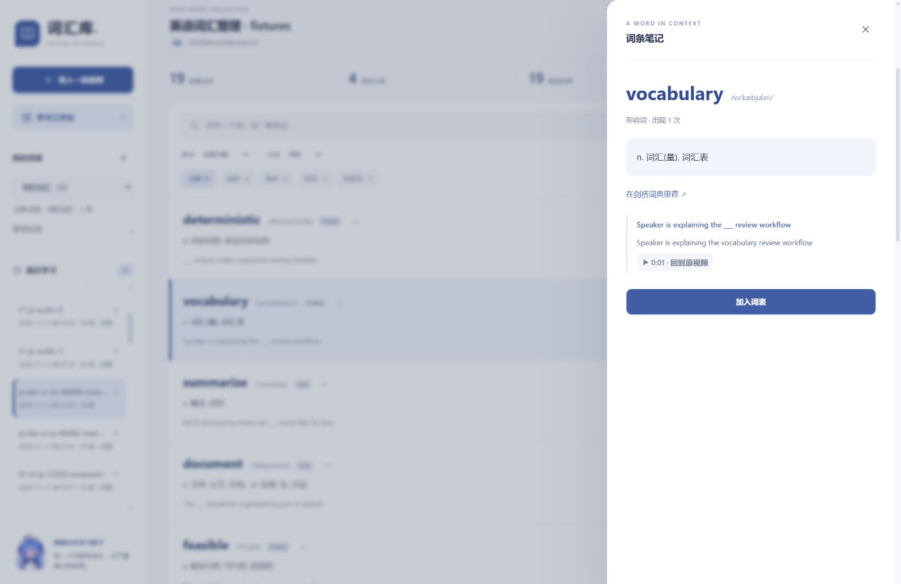
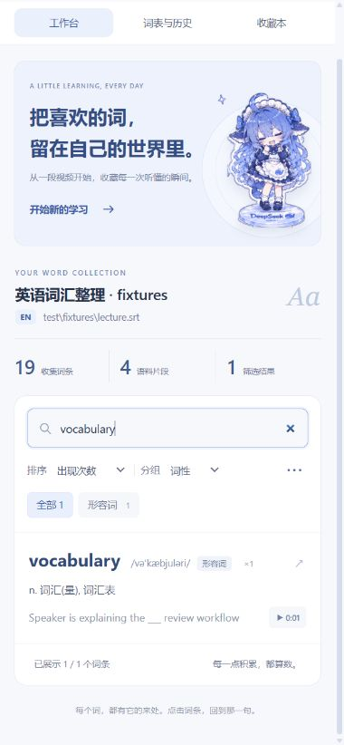

# 蓝白学习手账 · UI 改版验收

日期：2026-11-12（UTC+08:00）。范围：用户要求提高 UI 审美；交接里的功能路线作为背景，未整体扩展执行。

## 改了什么

- 重做 `app/public/app.html` 和 `app.css`：蓝白纸张配色、留白、字体层级、细线图标、欢迎插画、收藏本与纸张导出区。
- 使用用户提供的 `D:/GPT/绘图/clean-outlined-assets-v2/` 中九个 `clean-extraction` 素材：hero-standing，六个 sticker 表情，whale-icon，star-large。复制为 `img/studio-*.png`，原素材库未修改；服务端只允许扁平 PNG 路径，因此没有改动静态资源安全规则。
- 导入移入原生 dialog；词条详情移入侧边 dialog，支持 Esc、原生焦点约束、关闭后返回焦点。提示消息跟随模态层，关闭后回到页面。
- 历史按时间倒序；词形、音标/假名、释义与例句分层，词表长释义截断但可悬停查看。
- 词条首次只构建 50 个 DOM 节点，继续按钮追加 50 条并把焦点移到新内容。搜索和筛选仍对完整结果执行；这不是服务端分页，也不是虚拟滚动。
- 历史、筛选、词形、时间点改为真实按钮；补充可访问名称、焦点样式、跳过导航链接与减少动态效果支持。
- 手机采用工作台、词表与历史、收藏本三个页签；平板让收藏本落在词条区下方，避免三栏挤压。
- 防止旧的搜索/词表响应覆盖新选择；抓取过程中禁用重复提交与语言变更；接通原先未绑定的词表导出按钮。
- 用户说明和 README 同步新入口。没有修改后端分析、语言、entryKey、offset、个人词表、掌握记录或模型配置。

## 验证证据

| 验证 | 结果 |
|---|---|
| `node --test --test-isolation=none test/*.test.js` | 286/286，0 失败、0 跳过；日志 `ui-regression-final.txt` |
| 编码体检 | 123 文件通过 |
| `node tools/probe-browser.mjs` | 20/20；日志 `ui-dom-probe-final.txt`。它是 DOM 垫片逻辑验证，不是视觉证明 |
| 真实浏览器 | 在应用内 Chromium 预览检查英文、日文、空态、搜索、增量加载、详情、手机页签和导入提示 |
| 桌面 1440×960 | 英文 19 条、19 个音标、无日文读音；图片加载完整；无横向溢出 |
| 日语大列表 | 既有 772 词记录首批 50 条，点击追加后 100 条；搜索第 100 条的「僕」仍能返回匹配项 |
| 搜索 | 无匹配显示清除入口；清除恢复 50 条；英文 vocabulary 返回 1 条 |
| 详情 | 英日详情均显示原句；Esc 关闭；词典链接保留；未为日文编造释义 |
| 导入提示 | 日语+ASR 显示质量提示；关 ASR 或切英语后隐藏 |
| 平板 1024×900 | 无横向溢出，收藏区域进入下方双列 |
| 手机 390×844 | 工作台/历史/收藏页签可切换，导入弹窗可操作，无横向溢出；标题保持两行 |
| 浏览器控制台 | 最终英文预览无 error 日志 |
| ZIP 干净目录 | 重新解压至 `build/界面验收 干净目录-*`，全量自检通过，日志 `ui-release-check.txt` |

沙箱内首次全量回归为 285/286：Windows taskkill 无法及时终止测试子进程。普通权限环境单独复核超时测试通过（约 1.24s），之后完整回归 286/286；最终源文件再跑一次仍 286/286。没有为此修改 ASR 实现或放宽断言。

原有 DOM 探针只补原生 dialog 的最小可见状态和 classList.toggle(force) 语义；焦点和键盘行为由真实浏览器检查。既有历史证据保留。

## 真实截图

## 当前候选包

- 文件：`dist/词汇库-v1.0-windows.zip`
- 字节数：21,168,726
- 条目数：1392
- SHA-256：`2ce21fee7eb226d24e2309f7a6ca11a60cb6af3b52de8c685349b5de183945e3`
- 打包和解压验证已完成，未对外发布。

## 本轮边界

没有增加深色模式、批量词条操作、服务端分页、估算转写百分比或新的日文词典。真实联网抓取/转写未在本轮重跑，沿用现有测试与已知限制；Word 验证为包内结构与生成检查，不表示用 Word 应用人工复核过排版。

示例里的 `vocabulary` 词性标签仍来自既有分类数据（与词典释义不一致），本轮没有用界面改写数据修正它。后续内容质量工作应独立处理。
